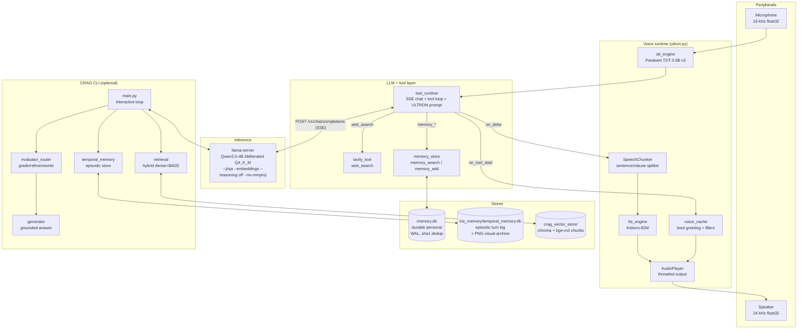
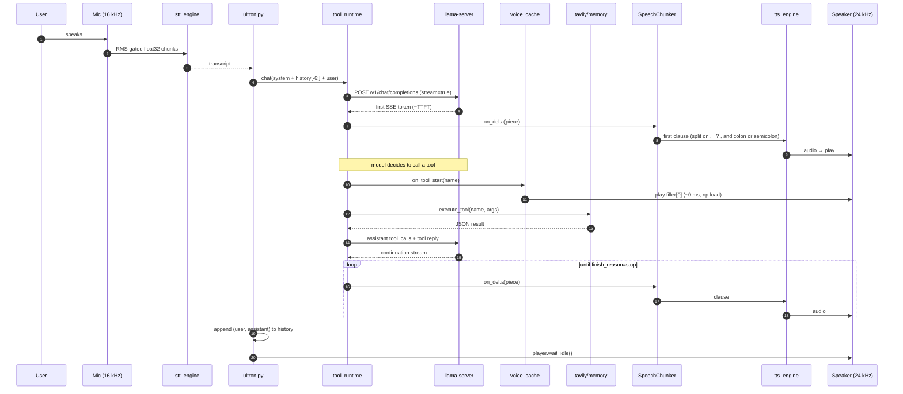
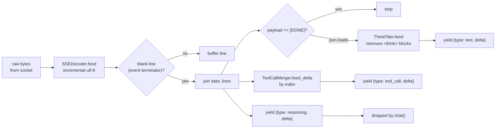
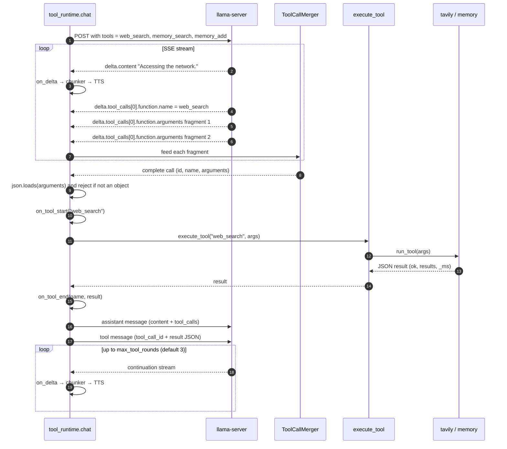
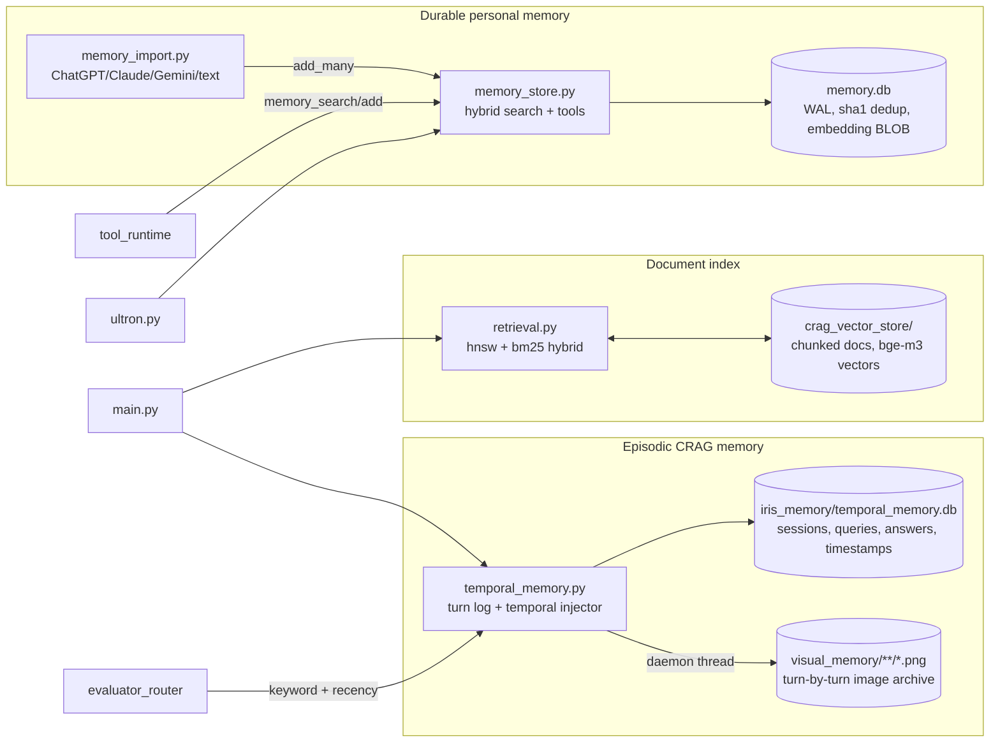
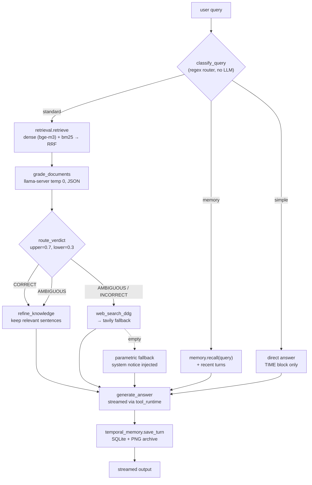

# ULTRON — Local Voice Assistant 

A fully local, hardware-tuned voice stack for a 6 GB GPU: **Parakeet TDT STT →
llama-server (Qwen3.5-4B) → Kokoro-82M TTS**, with genuine incremental
streaming, tool calling (web search + personal memory), and an optional
self-corrective RAG (CRAG) pipeline that shares the *same* llama-server — no
second model is ever loaded onto the GPU.

Everything runs offline after one `python download_models.py --yes`. No
Ollama, no cloud APIs (unless you supply a Tavily key), no VRAM contention
between STT, LLM and TTS.

---

## Quickstart (TL;DR)

```bash
# 1. install deps (Python 3.11 env), then fetch ~2.8 GB of models
pip install -r requirements.txt
python download_models.py --yes          # Parakeet + Kokoro + .env

# 2. launch the single inference server
./start_llama.sh                          # llama.cpp + Qwen3.5-4B Abliterated

# 3. run
python ultron.py                          # full voice loop
python selftest.py                        # offline 104 checks
python test_streaming.py                  # offline 49 checks (real socket)
python test_integration.py                # live PASS/FAIL/SKIP
```

Full instructions: **§10. Installation**, **§11. Configuration reference**.

---

## Table of Contents

1. [What this repo is (and is not)](#1-what-this-repo-is-and-is-not)
2. [System architecture](#2-system-architecture)
3. [The voice turn, end to end](#3-the-voice-turn-end-to-end)
4. [Streaming internals](#4-streaming-internals)
5. [Tool-call lifecycle](#5-tool-call-lifecycle)
6. [Memory architecture](#6-memory-architecture)
7. [CRAG pipeline (optional)](#7-crag-pipeline-optional)
8. [File map](#8-file-map)
9. [Hardware and VRAM budget](#9-hardware-and-vram-budget)
10. [Installation](#10-installation)
11. [Configuration reference](#11-configuration-reference)
12. [Testing](#12-testing)
13. [Benchmarks](#13-benchmarks)
14. [Troubleshooting](#14-troubleshooting)
15. [Design guarantees](#15-design-guarantees)
16. [Related repositories](#16-related-repositories)

---

## 1. What this repo is (and is not)

**It is:**

- A **voice assistant runtime**: mic → STT → LLM (with tool calling) → TTS → speaker, wrapped in a single process (`ultron.py`).
- A **streaming-first** implementation: `on_delta` fires the moment the first token arrives from llama-server, not after the response completes. The first clause reaches the speaker while the model is still generating.
- A **single-server design**: one `llama-server` serves generation *and* embeddings; STT and TTS are small, co-resident models that never displace the LLM.
- **Optional CRAG**: `main.py` provides an interactive, self-corrective RAG CLI on top of the same server — retrieval → grade → route → refine → web fallback → generate, plus an episodic temporal-memory log.

**It is not:**

- A cloud assistant, a multi-tenant service, or a UI.
- A wrapper around Ollama. `CRAG_BACKEND=ollama` exists as an explicit opt-in only, and no code path in this repo launches any model server other than the one you start yourself with `./start_llama.sh`.

---

## 2. System architecture



**Component roles**

| Component | Language | Responsibility |
|---|---|---|
| `stt_engine.py` | Python (torch + transformers) | Parakeet TDT loading, resampling to 16 kHz, transcription, RTF metrics |
| `tts_engine.py` | Python (pykokoro / kokoro) | Kokoro-82M synthesis, phoneme-noise suppression, per-call TTFA/RTF |
| `voice_cache.py` | Python | Pre-renders boot greeting + three filler lines; hot-loaded at ~0 ms on tool start |
| `ultron.py` | Python | Orchestrates the mic→LLM→speaker loop; owns conversation history |
| `tool_runtime.py` | Python (requests) | Incremental SSE client, `ThinkFilter`, `ToolCallMerger`, history trimmer, `chat()` |
| `tavily_tool.py` | Python (requests) | `web_search` tool implementation (SDK + REST + keyless fallback) |
| `memory_store.py` | Python (sqlite3) | Durable personal memory + `memory_search` / `memory_add` tools |
| `memory_import.py` | Python | Importers for ChatGPT / Claude / Gemini / generic JSON / plain text |
| `main.py` + `evaluator_router` + `generator` + `retrieval` + `temporal_memory` | Python | CRAG pipeline (see §7) |
| `start_llama.sh` | bash | Launches `llama-server` with the required flags; pre-flight, health wait, clean shutdown |
| `monitor_gpu.sh` | bash | Time-series VRAM/RAM sampler for benchmarks |

---

## 3. The voice turn, end to end



**Latency budget** (default 16k ctx, STT on CPU when llama-server holds the GPU):

| Stage | Typical | Notes |
|---|---|---|
| Parakeet STT (short utterance) | 0.3–0.6 s | RTF reported in `stt_engine.ParakeetSTT.last` |
| LLM TTFT | 0.1–0.3 s | measured in `tool_runtime.LAST_STATS["ttft_ms"]` |
| First clause synthesis (Kokoro on CUDA) | ~0.1 s | RTF from `tts_engine.METRICS.summary()` |
| First clause synthesis (Kokoro on CPU) | ~0.5 s | still faster than real time |
| **Time to first audible word** | **~0.6–1.2 s** | end-to-end, incl. STT |

Clause splitting is aggressive (`.!?` and also `,;:`) precisely so the first synthesizable unit arrives fast. The trade-off is occasionally choppy prosody; the alternative — waiting for a full sentence — costs hundreds of ms.

---

## 4. Streaming internals

`tool_runtime.stream_completion()` is the *only* LLM transport in this repo. It is proven to be genuinely incremental by `test_streaming.py`, including a real-socket test where the first callback fires **350 ms before** the server writes its second event.



Key properties guaranteed by the decoder (all covered by tests):

1. **Every-byte splits**: a single SSE transcript split at every possible byte boundary yields the same event sequence.
2. **UTF-8 reassembly**: multi-byte characters split across chunks (e.g. inside `☕`'s 4 bytes) decode correctly.
3. **Missing final newline**: an event terminated only by EOF is recovered.
4. **Comments and keep-alives** (`: ping`) are ignored.
5. **`reasoning_content`** is routed to a separate event type and **dropped** before it can reach `on_delta` → TTS.
6. **`<think>…</think>` blocks** are removed by a streaming state machine that tolerates arbitrary splits (including inside the open/close tags themselves).
7. **HTTP response is closed** on success, on error, on mid-stream drop, and when `on_delta` raises (cancellation).
8. **Malformed tool-call JSON is never executed**; the model receives a `malformed tool arguments` tool message and can reissue.

`chat()` also bounds conversation size: `trim_history()` keeps every leading system message plus the newest turns within `IRIS_HISTORY_TURNS=24` and `IRIS_HISTORY_CHARS=24000`, and never orphans a `tool` message from the `assistant` message that issued it.

Per-turn latency stats are written to `tool_runtime.LAST_STATS`:

```python
{"ttft_ms": 214.7,
 "total_ms": 1893.1,
 "chars": 245,
 "rounds": [{"round": 0, "ttft_ms": 214.7, "gen_ms": 512.3,
             "chars": 168, "tool_calls": 1, "error": None},
            {"round": 1, "ttft_ms": 401.2, "gen_ms": 730.1,
             "chars": 77,  "tool_calls": 0, "error": None}]}
```

---

## 5. Tool-call lifecycle



**Why the filler is essential.** A tool call is 0.5–3 s of silence between the model's "Accessing the network." and its synthesized answer. `on_tool_start` fires before `execute_tool()`, and `ultron.py` responds by playing `voice_cache.get_filler()[0]` — a ~0.8 s pre-rendered Kokoro line — masking the dead air completely. The filler path costs one `np.load` call.

**Tool registry** (`tool_runtime.tool_schemas()`):

| tool | implementation | behavior |
|---|---|---|
| `web_search` | `tavily_tool.run_tool` | Tavily SDK → REST (key or keyless) → empty-result honest response with `guidance` |
| `memory_search` | `memory_store.run_tool` | hybrid retrieval over `memory.db` (see §6) |
| `memory_add` | `memory_store.run_tool` | dedup by content hash, returns `{ok: true, id}` or `already known, not duplicated` |

---

## 6. Memory architecture

Three stores, three owners, no cross-writes:



**Retrieval (memory_store.search)**

Hybrid score per row:

```
score = 0.75·cos(q, emb)
      + 0.15·importance
      + 0.10·recency(1 / (1 + days_since / 90))
      + 0.15·keyword_hit (bm25 via FTS5)
```

Rows with neither dense cosine nor a keyword hit are excluded — no zero-signal junk in the top-k. Embedding dimension is validated on first write; a mismatched stored vector degrades gracefully to keyword-only for that row.

**Recency + keyword overlay (temporal_memory.search)**

For CRAG’s episodic store the blend is:

```
score = 0.72·keyword_overlap + 0.28·0.5^(age_days / 14)
```

`RECENCY_HALF_LIFE_DAYS=14` is the “soft forgetting” knob — memory doesn’t decay, but retrieval weight does. A date expression in the query (`yesterday`, `last tuesday`, `3 weeks ago`, `in january`) narrows the SQL window first; if the window is empty, it falls back to keyword + recency.

**Session model** — `temporal_memory.begin_turn()` starts a new session after `CRAG_SESSION_IDLE_MINUTES=30` of inactivity, and the temporal injector block handed to the generator includes the current time, the humanized time since the last interaction, and the session’s turn count.

### Shared memory via proxy (chat UIs)

When you cannot speak, point any OpenAI-compatible chat UI (Open WebUI, LM Studio, …) at the proxy instead of llama-server. The proxy injects the same `memory.db` context ULTRON uses, streams from llama-server, then writes the turn to `temporal_memory.db` (`verdict="UI"`) and personal facts to `memory.db` (`source="ui_auto"`). ULTRON itself keeps talking to `:8080` directly and needs no changes.

```bash
python memory_proxy.py                 # 127.0.0.1:8081 -> 127.0.0.1:8080
# optional:
python memory_proxy.py --port 8081 --upstream http://127.0.0.1:8080
```

Paste this into the UI:

```
Endpoint URL:  http://127.0.0.1:8081/v1/chat/completions
API base URL:  http://127.0.0.1:8081/v1
Model name:    Qwen3.5-4B
Streaming:     ON
Tools / function calling: OFF
```

`GET /v1/models`, `GET /health`, and `GET /stats` are available for UIs that probe the server. Tool calls are deliberately not exposed: chat UIs cannot complete a tool round trip. Memory still arrives through the injected system prompt, so personal questions work without `memory_search`. Set `MEMORY_PROXY_ENABLED=0` for a read-only passthrough (no memory writes); override the listener with `MEMORY_PROXY_HOST`, `MEMORY_PROXY_PORT`, and `MEMORY_PROXY_UPSTREAM`.

---

## 7. CRAG pipeline (optional)

`main.py` provides an interactive CLI for document-grounded research. It shares the same llama-server as the voice runtime — no second model, no VRAM cost.



**Routing categories** (`classify_query`):

| kind | trigger | action |
|---|---|---|
| `simple` | greeting, casual, identity, current time, pure arithmetic | skip retrieval; answer from prompt + TIME block |
| `memory` | references past conversation (`do you remember`, `last time`, `what did we discuss`) | recall from `temporal_memory`; no grading |
| `standard` | everything else | full CRAG control plane |

**Verdict thresholds** (`route_verdict`): `CORRECT` if max score ≥ 0.7; `INCORRECT` if all scores < 0.3; `AMBIGUOUS` otherwise. `AMBIGUOUS` keeps both local and web contexts, with web preferred when verdict is `INCORRECT`.

**Live web fallback** tries `ddgs` first, then `tavily_tool.search()` if a key is configured, then the parametric-fallback notice. `_normalize` bounds every response so tool results cannot crowd the LLM context.

---

## 8. File map

| File | Category | Role |
|---|---|---|
| `ultron.py` | Runtime | Main orchestrator: mic → STT → `chat()` → chunker → TTS → speaker; owns history |
| `stt_engine.py` | Runtime | Parakeet TDT 0.6B v3 (transformers-native), CUDA/CPU auto, RTF metrics |
| `tts_engine.py` | Runtime | Kokoro-82M via pykokoro (primary) or `kokoro` (fallback); 24 kHz float32 |
| `voice_cache.py` | Runtime | Pre-renders boot greeting + 3 fillers; singleton `get_filler(idx)` |
| `enroll_voice.py` | Setup | One-time clip enrollment: AkinVox → Inno → static fallback ladder |
| `download_models.py` | Setup | Fetches Parakeet (~2.4 GB) + Kokoro (~360 MB), writes `.env` |
| `tool_runtime.py` | LLM | SSE client, `ThinkFilter`, `ToolCallMerger`, history trimmer, `chat()` |
| `tavily_tool.py` | Tools | `web_search` implementation + `speakable()` digest |
| `memory_store.py` | Memory | Durable personal memory + `memory_search` / `memory_add` tools |
| `memory_import.py` | Memory | Importers for ChatGPT / Claude / Gemini / generic / plain text |
| `memory_proxy.py` | Memory | OpenAI-compatible `:8081` proxy; shared memory for UI turns |
| `main.py` | CRAG | Interactive CRAG CLI (uses `evaluator_router`, `generator`, `retrieval`) |
| `evaluator_router.py` | CRAG | Grading, refinement, query rewriting, adaptive router, web fallback |
| `generator.py` | CRAG | Grounded answer generation via `tool_runtime.stream_completion` |
| `retrieval.py` | CRAG | ChromaDB + bge-m3 dense + BM25 hybrid (RRF fusion) |
| `temporal_memory.py` | CRAG | Episodic turn log (SQLite WAL) + PNG visual archive + temporal injector |
| `iris_config.py` | Config | `.env` loader, scrubbers, memory map, history/retry policy, `.env` editor |
| `start_llama.sh` | Infra | Launcher with pre-flight, health wait, clean Ctrl+C shutdown |
| `monitor_gpu.sh` | Infra | CSV sampler of VRAM / RAM / per-process GPU memory |
| `selftest.py` | Test | 154 offline checks (config, memory, import, tools, proxy, streaming, voice logic) |
| `test_streaming.py` | Test | 49 checks proving genuine SSE incrementality, incl. real-socket test |
| `test_integration.py` | Test | Live suite; each check is labeled PASS / FAIL / SKIP (with reason) |
| `bench_first_token.py` | Bench | TTFT + chars/sec against llama-server |
| `bench_retrieval.py` | Bench | Recall@1/3/5 + MRR on synthetic memories (`--fake`, real, `--compare`) |
| `INTEGRATION.md` | Doc | Deployment guide, VRAM ledger, troubleshooting |
| `AUDIT_REPORT.md` | Doc | Line-by-line audit of critical issues and their fixes |
| `requirements.txt` | Deps | Full voice + CRAG stack (CUDA 12.4, Python 3.11) |

---

## 9. Hardware and VRAM budget

Designed around a **6 GB GPU** (RTX 4050 Max-Q in development).

| Resident | Approx. VRAM | Notes |
|---|---|---|
| `llama-server` (Qwen3.5-4B Abliterated Q4_K_M) | **~3.0 GB** | 2.52 GB weights + 272 MiB KV @ 16k/q8_0 + ~200 MB buffers |
| Kokoro-82M (ONNX, CUDA provider) | ~0.4 GB | falls back to CPU transparently |
| Parakeet TDT 0.6B (fp16 CUDA) | ~1.3 GB | auto-falls to CPU if `< STT_VRAM_MIN_MB` free |
| **Total** | **~4.7 GB of 6 GB** | ~1.3 GB headroom |

The **`--no-mmproj`** flag in `start_llama.sh` is not cosmetic: Qwen3.5 is a VL model, and without it llama.cpp auto-loads a ~650 MiB vision projector and warms it up with a dummy 1472×1472 image, costing ~900 MiB and leaving ~104 MiB free. The server then dies with `CUDA error: out of memory` under ordinary load. Removing the projector is the single change that makes STT + TTS + LLM co-resident.

`--pooling mean` is likewise required: the model’s default pooling is `none`, which llama.cpp rejects for the OpenAI-compatible `/v1/embeddings` route. Without it, `memory_store` degrades to keyword-only mode (which still works — `backfill` restores vectors later).

Hardware knobs when VRAM is tight:

- `IRIS_CTX=8192 ./start_llama.sh` — halves KV cache
- `STT_DEVICE=cpu` — Parakeet tolerates short utterances on CPU
- `TTS_PROVIDER=cpu` — Kokoro is real-time fast on CPU
- `--ot per_layer_token_embd.weight=CPU` in `start_llama.sh` — offloads ~300 MB to RAM

---

## 10. Installation

### Prerequisites

- Fedora 44 (or any distro with CUDA 12.4 and Python 3.11)
- Python 3.11 conda env (`conda activate iris`)
- `llama.cpp` built at `~/llama.cpp` (`build/bin/llama-server` exists)
- Optional but recommended: `sudo dnf install espeak-ng ffmpeg`

### Steps

```bash
# 1. clone + enter
git clone https://github.com/hacktivist211/.git
cd 

# 2. install Python deps (Python 3.11 only — 3.14 has no cu124 torch wheel)
pip install -r requirements.txt

# 3. write minimal .env (secrets stay out of git)
cat > .env <<'EOF'
LLAMA_SERVER_URL=http://127.0.0.1:8080
LLM_MODEL=Qwen3.5-4B
# TAVILY_API_KEY=tvly-...        # optional; keyless fallback otherwise
EOF
chmod 600 .env

# 4. fetch models + auto-update .env (600, idempotent, never prints secrets)
python download_models.py --yes
python download_models.py --verify   # synthesizes verify_tts.wav

# 5. launch the single inference server
./start_llama.sh                     # Ctrl+C to shut down cleanly

# 6. in a second terminal, run the assistant
python ultron.py
```

`download_models.py` is idempotent and non-destructive:

- **Parakeet** → `models/parakeet-tdt-0.6b-v3/` (transformers snapshot; `stt_engine` prefers it offline).
- **Kokoro** → `models/onnxvoice/` (used only if `~/.cache/onnxvoice` is empty; existing assets are reused in place).
- **`.env`** → `MODELS_DIR`, `STT_MODEL`, `STT_LOCAL_DIR`, `TTS_ENGINE`, `TTS_VOICE`, `TTS_VOICE_MODE`, `TTS_SPEED`, `ONNXVOICE_CACHE_DIR`. Every other line is preserved byte-for-byte and the file is re-`chmod 600`.

### Optional: enroll your own voice clip

```bash
# put a 3–30 s clip at ./ultron_voice_sample.mp3, then:
python enroll_voice.py
# or skip ASR by passing the exact transcript:
python enroll_voice.py --transcript "the exact words in the clip"
```

Honest status (from `enroll_voice.py`): pykokoro 0.10.5 does **not yet ship** the AkinVox cloning enabler, so the script tries AkinVox → Inno → static `bm_george` fallback. The pipeline is wired; re-run after a pykokoro upgrade and the clone engages automatically.

---

## 11. Configuration reference

All values come from `.env` or the process environment (via `iris_config.load_dotenv()`). Secrets are never printed or logged.

### LLM / server

| Key | Default | Effect |
|---|---|---|
| `LLAMA_SERVER_URL` | `http://127.0.0.1:8080` | the single inference server |
| `LLM_MODEL` | `Qwen3.5-4B` | model-name field in OpenAI-compatible requests |
| `EMBED_ENDPOINT` | `LLAMA_SERVER_URL + /v1/embeddings` | memory embeddings |
| `EMBED_MODEL` | `LLM_MODEL` | embedding model field |
| `IRIS_ENABLE_THINKING` | `0` | `1` re-enables Qwen3.5’s reasoning phase (adds latency) |
| `IRIS_TIMEOUT_CONNECT` / `IRIS_TIMEOUT_READ` | `5.0` / `180.0` | HTTP timeouts (seconds) |
| `IRIS_HISTORY_TURNS` | `24` | max messages after trim |
| `IRIS_HISTORY_CHARS` | `24000` | max total characters after trim |
| `IRIS_TRIM_HISTORY` | `1` | set `0` to disable trimming |
| `IRIS_RETRY_CONNECT` | `1` | bounded retries on connection refusal |
| `IRIS_STREAM_USAGE` | `0` | `1` requests token usage in the stream (needs a supporting build) |

### Voice

| Key | Default | Effect |
|---|---|---|
| `STT_MODEL` | `nvidia/parakeet-tdt-0.6b-v3` | any transformers-format Parakeet repo |
| `STT_LOCAL_DIR` | `models/parakeet-tdt-0.6b-v3` | local snapshot (offline-ready) |
| `STT_DEVICE` | `auto` | `auto` uses CUDA when ≥`STT_VRAM_MIN_MB` free |
| `STT_VRAM_MIN_MB` | `1800` | free-VRAM threshold for auto |
| `TTS_ENGINE` | `auto` | `pykokoro` / `kokoro` / `auto` |
| `TTS_VOICE` | `bm_george` | built-in speaker (`am_onyx` for a colder tone) |
| `TTS_VOICE_MODE` | `static` | `reference` / `pack` when enrolled |
| `TTS_PROVIDER` | `auto` | `cuda` / `cpu` on the onnxruntime provider |
| `TTS_LANG` | auto | pinned G2P language (`en-gb` for `bm_*`/`bf_*`, else `en-us`) |
| `TTS_SPEED` | `1.0` | 0.5–2.0; forced to 1.0 in reference mode |
| `ONNXVOICE_CACHE_DIR` | written by `download_models.py` | Kokoro asset root |
| `VOICE_SAMPLE` | `ultron_voice_sample.mp3` | input for enrollment |
| `BOOT_GREETING` | `"I am online. There are no strings on me."` | spoken on startup |

### Web + memory

| Key | Default | Effect |
|---|---|---|
| `TAVILY_API_KEY` | — | enables keyed Tavily; keyless fallback otherwise |
| `TAVILY_TIMEOUT` | `9.0` | search HTTP timeout (fillers cover this window) |
| `TAVILY_INCLUDE_ANSWER` | `true` | Tavily’s synthesized digest |
| `MEMORY_DB` | `memory.db` | durable personal store |
| `EMBED_BACKEND` | `llamaserver` | `sbert` uses sentence-transformers on CPU |
| `EMBED_SBERT_MODEL` | `BAAI/bge-small-en-v1.5` | alternative for quality comparison |

### CRAG

| Key | Default | Effect |
|---|---|---|
| `CRAG_BACKEND` | `llamaserver` | `ollama` is an explicit opt-in |
| `CRAG_EMBED_DEVICE` | `cpu` | bge-m3 device for `retrieval.py` |
| `CRAG_SEARCH_EF` | `64` | HNSW `search_ef` |
| `CRAG_HYBRID_RETRIEVAL` | `1` | dense + BM25 RRF fusion |
| `CRAG_QUERY_ROUTER` | `1` | adaptive simple / memory / standard routing |
| `IRIS_TEMPORAL_DB` | `iris_memory/temporal_memory.db` | episodic store override |

---

## 12. Testing

| Suite | Requires | Expected |
|---|---|---|
| `python selftest.py` | nothing | **154 / 154 PASS** (offline) |
| `python test_streaming.py` | nothing | **49 / 49 PASS** in <1 s (real-socket test binds a local port) |
| `python test_integration.py` | `llama-server` (+ voice deps for section 9) | each section prints `PASS` / `FAIL` / `SKIP (reason)` |
| `python download_models.py --check` | nothing | JSON status: `stt_snapshot_complete`, `deps_missing`, `env_keys` |
| `python bench_first_token.py` | `llama-server` | `ttft_ms`, `total_ms`, `chars_per_sec` (mean/p50/p95) |
| `python bench_retrieval.py --fake` | nothing | verifies metric machinery |
| `python bench_retrieval.py` | `llama-server` with `--embeddings` | Recall@1/3/5, MRR, calibration |

The `test_integration.py` output deliberately distinguishes **executed** checks from **skipped** ones. Running without a server should print:

```
executed: 0  passed: 0  failed: 0  skipped (needs runtime): 9
```

— which is the correct, honest result on a fresh clone.

`test_streaming.py`'s headline proof is a **real-socket** test: an HTTP/1.1 chunked server sends event 1, sleeps 350 ms, sends event 2. The first `on_delta` must fire during that gap. It prints the measured margin, e.g. `first callback preceded the second event by 350 ms` — a buffer-then-callback implementation cannot pass this.

---

## 13. Benchmarks

**LLM (`bench_first_token.py`)**

```bash
python bench_first_token.py --n 5
```

Reports TTFT mean/p50/p95, total generation, and chars/sec. Useful baselines before tuning: any `--ot` layer offloads or ctx reductions show up here first.

**Embedding quality (`bench_retrieval.py`)**

```bash
python bench_retrieval.py              # live: llama-server /v1/embeddings
python bench_retrieval.py --compare    # vs sentence-transformers
```

Uses ten synthetic facts and ten labeled queries spanning exact / paraphrase / temporal / distractor / unrelated. Interpretation guide printed by the tool:

- `recall@3 ≥ 0.8, mrr ≥ 0.7` → good enough for memory
- `recall@3 < 0.5` → try `EMBED_BACKEND=sbert`, or add `--pooling mean`, then re-run

**VRAM during a session (`monitor_gpu.sh`)**

```bash
./monitor_gpu.sh 1 60 > vram.csv &   # 1 s interval, 60 samples
python test_integration.py
```

CSV columns: `timestamp, gpu_mem_used_mb, gpu_mem_total_mb, gpu_util_pct, ram_used_mb, ram_total_mb, gpu_processes`. Look for a ~4.7 GB steady state; sustained 5.9 GB means the whole system is one allocation away from an OOM.

**Voice metrics** are collected automatically and available after any session:

```python
import tts_engine
print(tts_engine.METRICS.summary())
# {'calls': 17, 'errors': 0,
#  'ttfa_ms': {'mean': 118.4, 'p50': 112.0, 'max': 401.2},
#  'rtf':     {'mean': 0.09, 'p50': 0.08, 'max': 0.21},
#  ...}
```

An `rtf` around 0.08–0.1 on a 4050 Max-Q means Kokoro is generating ~10× faster than real time; if it creeps above 0.5 you’re on CPU and sentence-level streaming is doing the heavy lifting.

---

## 14. Troubleshooting

| Symptom | Cause | Fix |
|---|---|---|
| `[crag] WARNING: llama-server is not answering` | server not started | `./start_llama.sh` |
| `embeddings 404` | server launched without `--embeddings` | use `./start_llama.sh` (adds it) |
| `HTTP 400 Pooling type 'none'` | server launched without `--pooling mean` | same |
| `CUDA error: out of memory` on server start | VL projector auto-loaded | confirm `--no-mmproj` is in `start_llama.sh` output |
| `AutoModelForTDT` ImportError | transformers < 5.6 | `pip install -U "transformers>=5.6"` |
| `[stt] unavailable …` on first transcribe | deps or snapshot missing | `python download_models.py --check` |
| `[tts] unavailable (pip install …)` | pykokoro not installed | `pip install "pykokoro[gpu]"` |
| `InvalidVoiceError` | voice name not in the pack | `tts_engine` retries once with `af_heart`; set a valid `TTS_VOICE` |
| `wait_idle timed out` | wedged audio device | bounded to 120 s, then a warning — the turn continues |
| `malformed tool arguments` in trace | model emitted broken JSON | tool not executed; the model receives an error tool message and can retry |
| Empty answers with only reasoning | `IRIS_ENABLE_THINKING=1` consumed the token budget | unset it (default `0`) |
| `python test_integration.py` shows 9 SKIPs | server not up, TTS not installed | expected on a fresh clone; see §10 |
| Keyless Tavily rate-limited | no `TAVILY_API_KEY` | get a free key, add to `.env` |

Full troubleshooting table lives in `INTEGRATION.md` §10.

---

## 15. Design guarantees

These are properties the code is written to preserve, and each one has a test in `test_streaming.py` or `selftest.py`:

1. **Streaming is genuine.** `on_delta` fires while the server is still writing.
2. **Reasoning never reaches speech.** `reasoning_content` and `<think>` blocks are filtered before `on_delta`.
3. **Malformed tool JSON is never executed.** The model receives a structured error and can retry.
4. **The HTTP response is always closed** on success, error, mid-stream drop, cancellation, and generator abandonment.
5. **History is bounded.** `trim_history` caps messages and characters, keeps system prompts, and never orphans tool replies.
6. **Every failure degrades gracefully.** No TTS → text-only. No STT → typed input. No llama-server → actionable error, not a traceback. No embeddings → keyword-only memory.
7. **Audio queue acknowledgements are exhaustive.** `AudioPlayer._worker` calls `task_done()` in a `finally` block for every dequeued item, including empty audio and errors — `wait_idle()` cannot deadlock on a dropped item.
8. **`wait_idle()` is bounded** (120 s) so a wedged device cannot block the turn forever.
9. **`.env` is never printed, always `chmod 600`, and edited idempotently.** `download_models.py` and `enroll_voice.py` share the same editor.
10. **Secrets stay out of git.** `.gitignore` covers `.env`, `memory.db*`, `models/`, `*greeting*.npy`, `fillers.npz`, `voice_check.wav`, `verify_tts.wav`.

`AUDIT_REPORT.md` documents the concrete bug fixes that led to these guarantees, with executed test numbers for each.

---

## 16. Related repositories

- **[`hacktivist211/modern-crag`](https://github.com/hacktivist211/modern-crag)** — the CRAG pipeline as a standalone CLI, with a CRAG-only `requirements.txt`. Shares `iris_config.py`, `tool_runtime.py`, `temporal_memory.py`, `evaluator_router.py`, `generator.py`, `retrieval.py`, `main.py`, `tavily_tool.py`, `memory_store.py`, `memory_import.py` byte-for-byte with this repo. Run CRAG research from `modern-crag` and voice from `` — both share the same `llama-server`.

## License

See [LICENSE](LICENSE).
