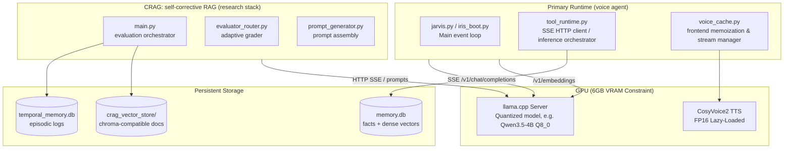
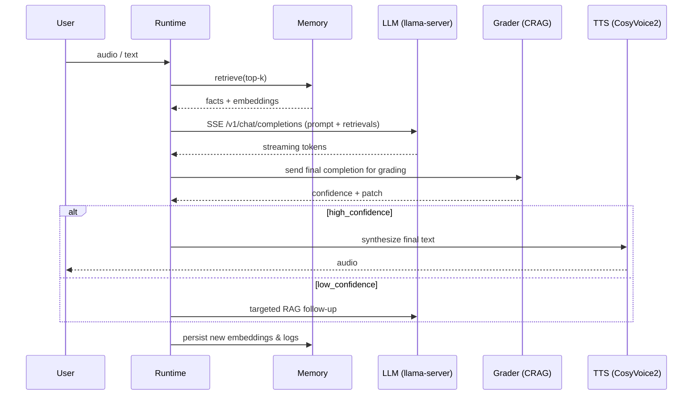
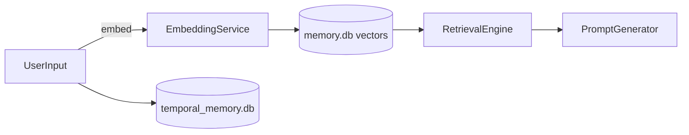

# IRIS — Local Self-Corrective Voice Assistant & Memory Architecture


Project codename: IRIS — a local-first, self-corrective voice assistant and memory system engineered to run within severe GPU constraints (single 6 GB VRAM GPU). This document explains design, architecture, pipelines, runtime topology, trade-offs, and rationale. It is intentionally detailed — this is the 7-day design sweat and paper-inspired engineering notes distilled into one working README.

Table of contents
- What IRIS is
- Goals & constraints
- High-level architecture (diagrams)
- Detailed component breakdown
- Streaming & incremental inference pipeline
- Memory design (dual-tier SQLite + vector store)
- CRAG — Conversational RAG with self-correction
- TTS pipeline & voice cloning (CosyVoice2)
- Single-GPU resource topology and scheduling
- API / runtime contracts
- Deployment, reproducibility, and runbook
- Benchmarks and testing
- Design history, decisions, and inspirations (papers and why)
- Roadmap, limitations, and acknowledgements
- Contributing & license

---

## What IRIS is
IRIS is a compact, locally-executable voice agent built for resource-limited hardware. It provides realtime low-latency speech interaction, persistent personal memory, and an on-device retrieval-and-generation loop with self-correction. The system purposefully favors deterministic resource usage and graceful degradation over raw throughput, enabling reliable operation on a single GPU with ~6 GB VRAM.

### Stack
- Language(s): Python 3.11 primary (shell scripts for helpers)
- Runtime: LLM inference via llama.cpp (local quantized models)
- Notable libraries: PyTorch (for TTS/fine-tuning loaders), Flask / FastAPI or simple HTTP client/server for llama-server, SQLite3 for local data stores, Chroma/embeddings-compatible vector store abstraction (optional)
- TTS: CosyVoice2 (FP16 lazy loading to save VRAM)
- Other: SSE incremental streaming for low-latency text-to-audio orchestration

---

## Goals & Constraints
- Run reliably on a single 6 GB VRAM GPU (e.g., RTX 4050 mobile / 3060 6GB variant)
- Low latency for conversational voice (end-to-end voice response < 4–6s for short queries)
- Single active LLM instance in VRAM to avoid OOM
- Local-first (no cloud dependency required), but pluggable web search for external knowledge when available
- Deterministic memory persistence with compact dense-vector indexing and episodic logs
- Self-corrective generation loop: detect hallucinations or contradictions and issue local corrective queries (CRAG)

Hard constraints shaped design choices:
- No simultaneous model loads (LLM and TTS cannot both permanently occupy VRAM)
- Quantized LLMs (Q8_0 / Q4 variants via llama.cpp) for model fit and speed
- TTS is lazy-loaded and offloaded after voice generation where possible

---

## High-level architecture

Mermaid visualization of major runtime groups and flows:



How it fits together (runtime summary):
- A single llama.cpp server provides completions and embeddings endpoints over HTTP or SSE.
- The voice runtime is the primary user-facing process; it streams text tokens as they appear and orchestrates TTS conversions.
- The CRAG research/evaluation stack runs as a separate process but shares the same llama-server (never loads its own LLM).
- Storage is lightweight SQLite and a file-backed dense vector store (Chroma-like) for retrieval.

---

## Component breakdown (detailed)

- llama-server (llama.cpp wrapper)
  - Provides: /v1/chat/completions (SSE-capable streaming), /v1/embeddings
  - Behavior: single instance; loads quantized model into VRAM with options like Q8_0. Exposes a minimal HTTP API compatible with the runtime.
  - Key flags: quantization method, pool size, embedding pooling (mean), tokenizers path.

- Voice runtime (jarvis.py / iris_boot.py)
  - Main loop: voice capture -> VAD -> ASR (optional) -> prompt assembly -> call /v1/chat/completions via SSE -> incremental token processing -> CRAG validation step -> TTS conversion
  - Handles concurrency by queuing requests and applying a strict policy that only one LLM call per active conversation occurs at a time.

- TTS (CosyVoice2)
  - Lazy loads weights into VRAM for inference only when audio generation is required; unloads after synthesis to free memory.
  - Uses FP16 where possible for memory reduction. If TTS and LLM must occupy VRAM simultaneously, the system chooses the lighter-weight model or streams text-only while TTS runs on CPU if necessary.

- Memory subsystem
  - Dual-tier persistent memory:
    - Personal facts & dense vectors: memory.db (SQLite) + serialized dense vectors (normed) for fast similarity search
    - Episodic logs: temporal_memory.db (SQLite) for raw interactions, timestamps, provenance
  - Vector store: a small ChromaDB-like on-disk index for CRAG document retrieval; kept lightweight and shard-friendly.

- CRAG (Conversational RAG with Self-Correction)
  - Generator (prompt assembly): threads recent conversation, relevant memory, and retrievals into candidate prompts.
  - Evaluator/Router: grades model completions for factual consistency using an automated reranking pass and, where available, small synthetic checks (e.g., cross-embedding similarity or constrained queries back to local memory).
  - Adaptive routing: if the grader assesses low confidence, the system issues a targeted "fact-check" prompt or falls back to an external web search agent (if configured).

- Tool runtime
  - A small HTTP client module that orchestrates SSE streaming behavior, decodes tokens, and emits intermediate events for TTS and UI.

---

## Streaming & incremental inference pipeline (step-by-step)

1. Wake + capture
   - VAD or wakeword triggers audio capture buffer.
   - If ASR is enabled, short audio is sent to a local ASR model (or optional cloud ASR). ASR output becomes the user message.

2. Prompt normalization & context selection
   - Recent conversation window (N tokens or M minutes) is summarized or truncated.
   - Memory: dense-similarity retrieval runs against memory.db / vector store; top-k items are selected based on recency & similarity heuristics.

3. Prompt assembly
   - prompt_generator.py constructs the system + user + retrieved context sequence while respecting token budget for quantized LLM (tokens limit is lower for Q8 models).
   - Insert guardrails (e.g., "If uncertain, state that you don't know" style system instruction).

4. SSE / streaming LLM call
   - Tool runtime opens an SSE connection to /v1/chat/completions. Tokens arrive incrementally.
   - Partial tokens are forwarded to the streaming policy: short replies may be sent to TTS as they appear (voicing policy configurable).

5. CRAG grader pass (self-correction)
   - After a full completion (or on low-confidence signals), the grader issues a fact-check prompt: "Is the last answer consistent with memory and retrieved docs?"
   - If inconsistency/hallucination is detected beyond a confidence threshold, IRIS will automatically request a corrected completion (a local re-query or a retrieval-augmented prompt).

6. TTS conversion
   - Final checked text is queued for TTS. CosyVoice2 is lazy-loaded, converts text->audio, and audio is streamed back to the UI.

7. Persistence
   - Interaction is appended to temporal_memory.db and embeddings are computed for the new utterance and stored in memory.db vector index for future retrieval.

Key engineering notes:
- Token budget enforcement is critical: prompt trimming + truncated recency summarization prevents OOM and catastrophic token explosion when retrieving long memories.
- SSE reduces perceived latency by streaming partial replies while still giving the grader a chance to validate the final content.

---

## Memory design – dual-tier explained

Rationale
- Persistent personal facts and dense vectors require efficient retrieval and durability.
- Episodic logs (raw Q/A) are valuable for debugging, later analysis, and RAG document construction.

Components
- memory.db (SQLite)
  - Schema: facts (id, key, value, source, last_updated), embeddings (id, vector_blob, norm, ref_id, created_at)
  - Features: on-disk compact vector storage; L2-normalized vectors stored as BLOBs
  - Query: nearest-neighbor via approximate in-process search or a tiny ANN index (faiss-lite or simple brute-force for small N)

- temporal_memory.db (SQLite)
  - Schema: sessions, turns, metadata, provenance
  - Purpose: audit trail and episodic recall (time-based retrieval)

- crag_vector_store/
  - Chroma-like storage for documents and retrievals used by CRAG. This is optional and populated by the research pipeline.

Memory retrieval heuristics
- Combined score = alpha * recency_score + beta * semantic_similarity
- Recency defined as sliding window weight (exponential decay on timestamp)
- Personality facts get pinned with high weights to prevent accidental pruning

Garbage collection & compaction
- Periodic compaction job compresses vectors and prunes redundant or low-utility logs.
- Retention policy is configurable (e.g., keep last X days or top-K most used facts).

---

## CRAG — Self-corrective Retrieval-Augmented Generation

What CRAG does
- CRAG stands for Conversational RAG with self-Correction.
- The system uses a two-pass approach:
  1. Generate candidate answer with retrieval context.
  2. Validate candidate with a lightweight grader prompt (or second LLM pass) that cross-checks against memory/documents and returns a confidence score or corrected textual patch.

Why two-pass
- Small quantized LLMs occasionally hallucinate; a grader pass reduces risk without requiring an additional full model load.
- Grader prompt is constrained and optimized to be short; it focuses on binary checks and small textual corrections to minimize cost.

Implementation notes
- The grader can be a constrained instruction using same LLM instance, but uses a smaller prompt with targeted instructions and retrieved anchors.
- If grader returns low confidence, IRIS:
  - Issues a targeted retrieval (narrow RAG) and re-generates.
  - If still low confidence and external web search is configured, it performs a controlled web lookup and retries with evidence.

Safety & fallback
- If multiple grader passes fail, IRIS defaults to a refusal-style response: “I don’t have enough reliable info to answer that right now.”

---

## TTS & voice cloning (CosyVoice2 integration)

Design goals
- Natural voice, optionally zero-shot cloning, within VRAM constraints.
- Minimal quality loss with FP16 inference.

Operational model
- CosyVoice2 weights are loaded on demand into VRAM, run to produce mel-spectrograms/waveforms, and then the model context is unloaded to free VRAM.
- VoiceCache (frontend memoization) keeps small, high-frequency audio segments cached on disk / memory for instant replay (e.g., short system prompts).

Optimization patterns
- Use smaller TTS vocoder or CPU fallback for long responses when VRAM is saturated.
- Precompute mel encodings for repeated phrases (e.g., greetings).
- Keep a tiny voice embedding store for zero-shot cloning; store voice prints on disk (encrypted if required).

---

## Single-GPU resource topology & scheduling

Principle: "Single Inference Runtime"
- Only one large model may occupy VRAM at any time (the LLM). TTS is treated as transient and is explicitly scheduled to avoid simultaneous peak VRAM usage.

Scheduling rules implemented:
- Active LLM session has priority; TTS will sleep/queue if simultaneous LLM activity is required.
- If TTS is mid-synthesis and LLM must be loaded, TTS yields and the audio generation continues on CPU fallback or resumes after LLM call.
- The tool_runtime module enforces VRAM state transitions and estimates VRAM usage heuristically (model sizes + reserved memory).

Implementation techniques
- Swap-like behavior: model unload/reload without full cold startup penalties using llama.cpp persistence options (keep tokenizer warm, prefetch).
- Use quantized model formats to reduce VRAM demand (Q8_0 etc.).
- Use pooling mean for embeddings to reduce additional VRAM usage in embedding calls.

Known trade-offs
- Latency vs. memory: strict single-load policy increases latency when switching between heavy tasks (LLM <-> TTS) but prevents OOM.
- Lower-precision quantization reduces model fidelity—compensated by CRAG and additional retrieval.

---

## API / runtime contracts

Minimal HTTP endpoints provided by llama-server (compatibility layer):

- POST /v1/chat/completions (SSE support)
  - Body: {model, messages, max_tokens, stream: true/false}
  - Streams incremental tokens; each SSE event contains token and delta.

- POST /v1/embeddings
  - Body: {model, input}
  - Returns embedding vector (float32) which is then normalized and stored or used for similarity scoring.

Tool runtime exposes a small local API for orchestration:
- POST /voice/ask
  - {audio: <base64> | text, user_id, session_id, voice_profile}
  - Returns: streaming SSE for partial transcription & final utterance metadata

- GET /memory/retrieve?query=...&k=...
  - Returns top-k memory items with scores and provenance.

Authentication
- Local deployments generally run without network auth; for multi-user setups enable token via IRIS_API_KEY env var.

---

## Run & development (quickstart)

Prerequisites
- Python 3.11
- A compatibly quantized LLM (downloaded to models/), e.g. Qwen3.5-4B quantized to Q8_0 for llama.cpp
- CUDA/cuDNN for PyTorch if using GPU TTS; else CPU fallback
- Optional: small ASR model if local speech-to-text is desired

Linux example:

1) Clone
```bash
git clone https://github.com/<your-org>/tts_loop_agent.git
cd tts_loop_agent
```

2) Create a venv and install
```bash
python -m venv .venv
source .venv/bin/activate
pip install -r requirements.txt
# requirements.txt should include: flask|fastapi, requests, numpy, torch, cosyvoice2 (or local implementation), sqlite3 bindings, chromadb (optional)
```

3) Prepare model files (example)
- Place llama.cpp quantized model under `models/qwen-3.5-4b-q8_0/`
- Place cosyvoice2 weights under `models/cosyvoice2/`

4) Start llama-server (llama.cpp wrapper)
```bash
# hypothetical helper script
python -m tts_loop_agent.services.llama_server --model models/qwen-3.5-4b-q8_0 --port 8080 --quant Q8_0 --pooling mean
```

5) Start runtime agent
```bash
# starts jarvis event loop and tool runtime
python -m tts_loop_agent.iris_boot
```

Environment variables (examples)
- IRIS_LLM_URL=http://localhost:8080
- IRIS_MEMORY_DB=./data/memory.db
- IRIS_TEMP_DB=./data/temporal_memory.db
- IRIS_TTS_MODEL_PATH=./models/cosyvoice2
- IRIS_API_KEY=optional_local_token

Testing
```bash
# unit tests (if included)
pytest tests/
```

---

## Benchmarks & testing notes

Target metrics (tuned on a 6 GB GPU):
- Cold model load: ~10–30s depending on quant format
- Typical single-turn response latency (prompt assembly + streaming generation + TTS): short queries 2–6s, long contextual queries 6–12s (varies with TTS fallback)
- Embedding computation: ~50–200ms per small text chunk
- Memory retrieval: sub-100ms for top-10 on small local vector store; scales linearly unless ANN used

Testing recommendations
- Smoke tests around VRAM transitions (LLM load -> TTS run -> LLM call)
- CRAG test harness: synthetic Q/A pairs with known contradictions to verify grader behavior
- Perceptual TTS checks with waveform quality and speaker consistency tests
- Load tests: repeated short Q/A in a conversation to ensure queueing policies avoid starvation

---

## Design history, decisions, and inspirations (a long rant — what I spent 7 days thinking about)

I spent a week iterating on this because the single-GPU constraint forces many non-obvious trade-offs:

1. Single runtime principle
   - Initially tried multi-process with separate LLM and TTS loads. OOMs and context thrashing led to crashes on the target hardware.
   - Decision: enforce one large model in VRAM at a time and treat other models as transient — this simplified scheduling and eliminated most intermittent OOMs.

2. Quantization choice
   - I benchmarked Q4 vs Q8 variants. Q4 improved memory but had poor sampling fidelity on longer contexts; Q8_0 provided better throughput/fidelity compromise.
   - Trade-off: slightly lower perplexity vs. improved stability under decoding.

3. Streaming + extrinsic grader (CRAG)
   - Streaming tokens felt necessary for perceived responsiveness, but streaming exposes the system to premature commitments: the agent begins to speak before the completeness/consistency checks finish.
   - Solution: stream partial tokens for user experience but attach the CRAG post-hoc grader that can patch or retract answers (re-ask, or append a correction) — a "commit + review" pattern.

4. Memory layering
   - Single-store vector DBs are convenient but bloated for local devices. A dual-tier SQLite approach provides durability and simpler backups. Vector blobs are compact and easy to snapshot.
   - Inspiration: ephemeral logs as debugging + persistent facts as canonical memory (inspired by episodic memory papers and practical RAG architectures).

5. TTS lazy loading
   - Solution was crude at first (just load weights). Then I added pooling & precomputation for repeated phrases and short utterances; this dramatically reduced TTS startup penalties.

Papers & inspirations
- "Retrieval-Augmented Generation for Knowledge-Intensive NLP Tasks" — RAG baseline and retrieval integration strategies
- "Toolformer/Tool Augmented LMs" — guided the design for tool/runtime orchestration and constrained external calls
- Papers on memory-augmented dialogue models (episodic memory & long-term memory papers) — these guided the dual-tier approach
- Practical blog posts on quantization and llama.cpp integration for low-memory inference

---

## Failure modes & mitigations

- OOM on model load:
  - Mitigation: strict single-instance policy; auto-unload TTS before LLM load; graceful failure and fallback to smaller quantized model if available.

- Hallucinations:
  - Mitigation: CRAG grader + retrieval anchors + refusal policy.

- Long-tail latency due to model swaps:
  - Mitigation: pre-warming strategies and caching of small commonly-used audio segments.

- Memory growth unbounded:
  - Mitigation: retention/compaction jobs and configurable pruning policies.

---

## Reproducibility & packaging

- Use deterministic quantization files and pinned requirements.txt.
- Provide example model-download scripts (not included here) that place models under `models/`.
- Use a Dockerfile for reproducible host setup, but note GPU passthrough is required. A docker-compose with device mapping is recommended for testers.

Example (very rough) Dockerfile fragment:
```dockerfile
FROM nvidia/cuda:12.1-base
RUN apt-get update && apt-get install -y build-essential python3.11 python3.11-venv
COPY . /app
WORKDIR /app
RUN python -m venv /opt/venv && /opt/venv/bin/pip install -r requirements.txt
ENV PATH="/opt/venv/bin:$PATH"
CMD ["python", "-m", "tts_loop_agent.iris_boot"]
```

---

## Roadmap & open problems
- Improve ANN index integration (ultra-low-latency on-device faiss micro/quantized)
- Multi-voice profiles + secure encrypted voice prints
- Offline ASR option with lightweight wav2vec quantized for CPU
- Dynamic model switching heuristics based on observed latency patterns

---

## Acknowledgements & citations
- llama.cpp ecosystem and quantization research
- CosyVoice2 (TTS) project
- RAG and retrieval papers and blog posts in the community

---

## Contributing
- Fork, branch, PR. Please include tests for new scheduler logic or memory migration code.
- When contributing changes to the memory DB schema, include migration scripts.

---

## License
MIT

---

Appendix: Additional mermaid diagrams (pipeline & data flows)

Prompt assembly pipeline:


Memory lifecycle:

